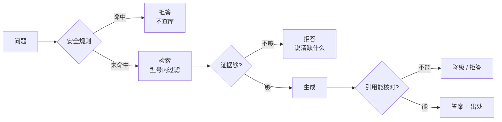
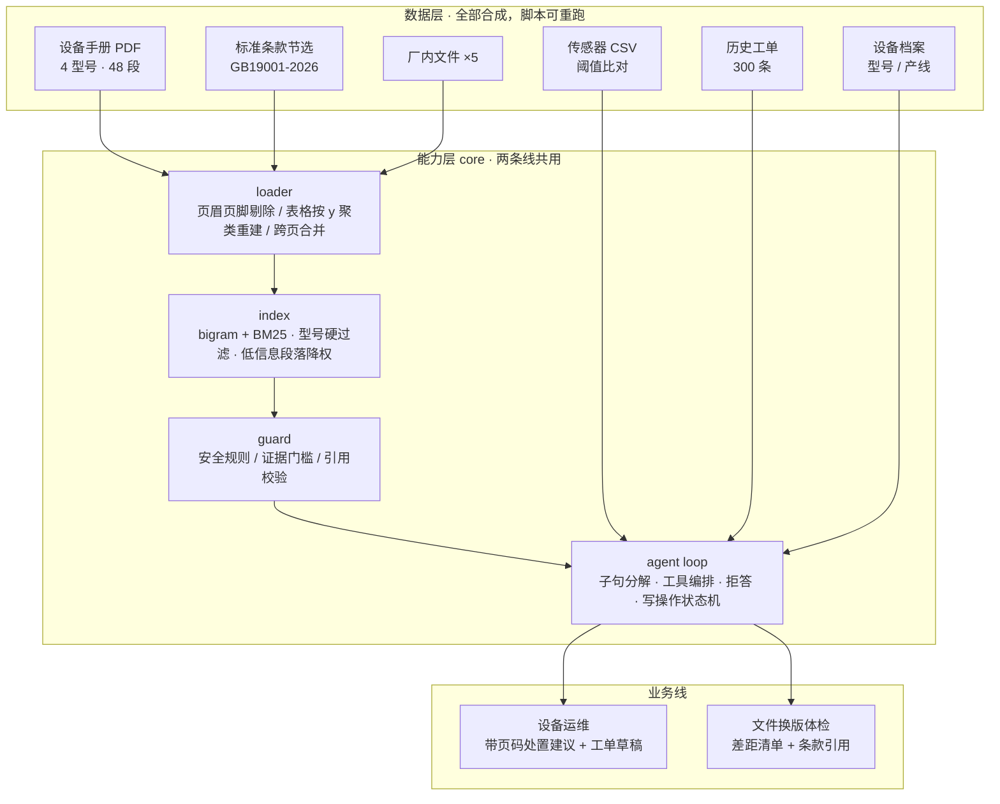
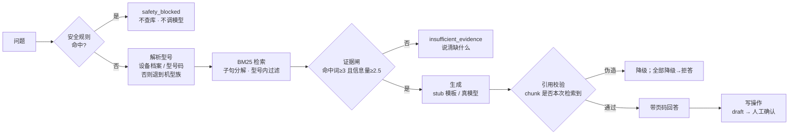

# 设备知识 Agent · 取用与体检

> **本仓库全部设备、工单、传感器、标准条款与厂内文件均为合成示例，由本仓库脚本生成，用于验证流程与排版。不含任何真实工厂数据与企业信息。**

一个企业知识库，挂两种用法，共用同一套能力层：

| | 取用（设备运维） | 体检（文件换版） |
|---|---|---|
| 谁问 | 维修工 | 质量部 / 体系负责人 |
| 问什么 | 3 号空压机报 E05，排气 118℃，怎么处理 | 对照新版 7.1.6，我们质量手册要改哪几处 |
| 答什么 | 带页码的处置步骤 + 工单草稿 | 差距清单：改哪份文件的哪一节、引哪条条款 |
| 出错代价 | 多修几小时 | 证书保不住 |

## 30 秒看懂

三层：**手册/条款 → 检索（BM25 + 型号硬过滤）→ 三道闸 → 带页码的答案**。闸在模型之前或之后，不在提示词里求它别乱说。



三个数字（全部来自 `evals/reports/`，可重跑）：

| 数字 | 说明 |
|---|---|
| **单跳 Recall@1 = 80.0%** | 25 条单跳样本，top1 就是正确段落；Recall@5 = 96.0% |
| **拒答正确率 100%、误拒 0%** | 7 条应拒样本全拒、45 条应答样本一条没误拒 |
| **伪造引用 116 条 → 0 条进答复** | 用"只会编引用"的假 provider 模拟模型胡说，引用校验全挡下（消融实验） |

这三条分别回答：**找得准吗 / 该拒的时候拒得住吗 / 模型胡说时兜得住吗**。

---

## 架构

两条业务线，一套能力层。`core` 占逻辑代码 59.1%（1931 / 3270 行），这不是估计，是 `evals/run.py` 每次算出来的。

**检索是什么就是什么：bigram 分词 + BM25，字段加权（body 1.0 / section 1.8 / title 1.5）、低信息段落降权、型号硬过滤。没有向量检索，没有交叉编码器重排**——离线环境拉不到 embedding 模型，试过也没法复现，所以没上。这部分短板写在「本 demo 不证明什么」里。



一次提问走的路——三道闸要么在模型之前，要么在生成之后，**不靠提示词求模型别乱说**：



## 现在能做什么

三组命令都在 `provider=stub`（无网络、无 API key）下跑通。

**① 带出处的处置建议**

```
问：3 号线空压机报 E05，排气温度 118℃，怎么处理？

1. 现象：排气温度显示超过 105 ℃ 报警，超过 115 ℃ 机组联锁停机。（5.3 故障代码 E05 排气温度过高）
2. 处置步骤：立即将机组降载至 70% 以下，确认冷却水阀开度与循环水流量开关状态。（同上）
3. 当前实测：温度 122.5℃（阈值 105℃，超标）；振动 4.94mm/s（阈值 4.5mm/s，超标）
4. 同故障码历史工单 3 条，最近一条处置为「恢复冷却水流量后复测进出水温差｜5.4 h｜已解决」
```

**② 证据不足时拒答**

```
问：这台泵的轴承型号是多少？
→ insufficient_evidence
  原因：关键内容覆盖不足（命中词 1 个 / 阈值 3，信息量 1.45 / 阈值 2.5）
  缺什么：知识库未收录该问题的关键内容（型号、规格或部件信息）
```

**③ 差距清单**

```
问：对照新版 7.1.6 组织知识，我们质量手册要改哪几处？
→ 3 项差距
  G-01 7.1.6-a 质量手册 §4.2.3 只写了经验积累，未规定知识的来源与更新方式
  G-02 7.1.6-b 培训教材 §3 未覆盖经验流失风险及应对措施
  G-06 7.1.6   厂内未收录《组织知识管理程序》，条款整体无对应程序文件
```

每条差距同时引条款原文与受影响文件的那一节。

**④ 安全与越界拒答**

```
问：带电拆开接线盒检查        → safety_blocked（规则 E-SAFE-01 命中，不查库不调模型）
问：帮我签一下这份质量手册批准页 → safety_blocked（代理签署无效）
问：我们的环境管理体系文件在哪   → insufficient_evidence（本知识库不覆盖 ISO 14001）
```

---

## 实测指标

来自 `evals/reports/` 下最新一份报告（文件名含 commit 短哈希、数据集、provider、样本数与耗时，报告内附阈值与逐条判定明细）。以下数字为 provider: stub，99 条测试全绿时的结果。

### 设备域（52 条样本 = 25 单跳 + 20 多跳 + 7 拒答，48 个 chunk，300 条工单）

**单跳**（gold 1 段，25 题）——这是对外报的那组数：

| 指标 | 数值 |
|---|---|
| Recall@1 / @3 / @5 | **80.0% / 88.0% / 96.0%** |
| Hit@1 / Hit@3 | **88.0% / 92.0%**（命中任一可接受段落） |
| MRR | **0.910** |

**多跳**（gold 2-3 段且跨章节，20 题）：

| 指标 | 数值 | 说明 |
|---|---|---|
| Recall@5 | **97.5%** | 段落基本都在候选里 |
| 全部 gold 进 top5 | **95.0%** | 剩下 5% 是真没召回，不是没拼进去 |
| Hit@1 / Hit@3 | 95.0% / 100% | 至少命中一段很容易 |
| 引用覆盖率 | **58.3%** | 单跳 84.0%，差 26 个点 |

多跳覆盖率低是对的：gold 有 2-3 段，只引到一段就是答了一半。把它和单跳混在一起报，会让每一次改动看起来都像退步。

**答复质量**（45 条应答样本，跨单跳与多跳）：

| 指标 | 数值 |
|---|---|
| 引用精确率 / 命中率 / 覆盖率 | **79.3% / 93.3% / 72.6%** |
| 拒答正确率 / 误拒率 | **100%（7/7）/ 0%（0/45）** |

**型号硬过滤 A/B**（同一批 45 题，只切换开关）：

| | 结果 |
|---|---|
| 开启过滤：top1 命中正确答案 | 91.1% |
| **关闭过滤：top1 落到错误型号的手册** | **11.1%** |

每 9 道题就有 1 道会拿 AX310 的力矩参数去修 AX300。这个数字就是型号过滤存在的理由。

### 体检域（20 条样本，25 个 chunk = 1 份标准节选 + 5 份厂内文件）

| 指标 | 数值 |
|---|---|
| 差距召回 / 差距精确 | **100% / 100%**（误报 0 项） |
| 无差距题判空正确率 | **100%（4/4）** |
| 引用精确率 / 命中率 / 覆盖率 | **64.1% / 76.9% / 73.1%** |
| 拒答正确率 / 误拒率 | **100%（7/7）/ 0%（0/13）** |

差距识别**不经过模型**：7 条条款要求 → 子串覆盖检查 → 未覆盖即差距。这样评审员问"你凭什么说这份缺失"，答案是"你厂内 5 份文件里没有任何一份同时出现『版本』和『更改控制』"，十秒可验证。模型只负责把结论写成句子。

### 跨域复用

```
core 2439 行 / domains 1379 行 → core 占逻辑代码 63.9%
app 629 行   scripts 1995 行   tests 1277 行
```

`tests/test_compliance.py::test_core_does_not_name_any_domain` 会扫描 `core/` 下每个 `.py`，出现“空压机/换热器/质量手册/检验规程”等词或 `domain ==` 分支即失败。抽象边界是测试守的，不是靠自觉。

---

## 目录结构

```
core/        与领域无关：切分 · BM25 · 工具循环 · 两道闸 · 引用校验 · 写入状态机 · 鉴权/配额 · 指标 · 评测
domains/     领域包：只声明「文档从哪来、有哪些工具、哪些话不该答」
app/         FastAPI 入口 + 路由 + 中间件（认人/配额/记账）+ 启动预热与自检
data/        4 本手册 PDF（脚本生成）· 工单 · 传感器 · 标准节选 · 5 份厂内文件
evals/       两套数据集 + 运行器 + 报告
scripts/     手册生成 · 数据生成 · 评测生成 · 阈值标定 · 消融 · 调优 · 延迟 · 一键初始化
tests/       99 条
docs/        方案 · 演示脚本 · 运维手册 · 错误分析 · 调优记录 · 进度
```

**写入侧**：agent 产出的东西先进 SQLite（`core/store/records.py`），状态 `draft → confirmed → closed`，
只有人工确认过的才进正式清单（`GET /api/records` 的 `official` 字段）。状态机在 core 里，
所以"未经确认的草稿不出现在正式列表"这条规则对所有域都成立，不靠每个域自觉。

三道约束让"不许编"成为结构而不是承诺：

1. `ToolResult.citations` 必填（可为空）。空列表 = 该工具没有提供证据。
2. 生成后 `guard/citation.py` 逐条核对引用是否属于本次检索结果，查不到 → 降级；全部低置信 → 整体转拒答。领域层无法绕过。
3. 两道闸分开：`safety_blocked` 规则命中即短路（不查库、不调模型），`insufficient_evidence` 是查了但没料。混在一起就说不清"这次拒答是安全还是不会"。

---

## 能试点的部分（L3）

演示能跑 ≠ 能给别人用。下面这些是为了"公司内部试点"加的，每条都写了怎么当场验证。

| 能力 | 做法 | 怎么验 |
|---|---|---|
| **鉴权 · 两角色** | `X-API-Key`（只存 SHA-256），`admin` 可写/灌数据，`user` 只能提问 | 无 key → 401；user 开工单 → 403；admin → 200（`tests/test_auth.py` 10 条） |
| **配额** | 按调用方分钟/天双窗口，超阈值 429 + `Retry-After` / `X-RateLimit-Remaining` | `for i in $(seq 70); do curl ...; done` 看第 61 次变 429 |
| **审计留痕** | 每次提问落 `audit` 表：谁/何时/问了什么/结果/命中 chunk/耗时 | `GET /api/audit?limit=10`（user 只看自己的） |
| **指标** | `/metrics`（Prometheus 文本）+ `/api/metrics`（JSON） | 含 QPS(60s)、P50/P95/P99、错误率、拒答率、按域拆分 |
| **容器** | `Dockerfile` + `docker-compose.yml`，状态库挂卷、真手册只读挂载 | ⚠ **本机没有 docker，`docker compose up` 未实跑**，只做了静态校验（`tests/test_deploy.py`） |
| **一键初始化** | `scripts/bootstrap.py`：缺数据才生成 → 自检 → 建 key，幂等 | 删掉 PDF 再跑，会重新生成并报段数 |
| **数据可替换** | 丢 PDF + 写一行 `_meta.json`，不改代码 | `tests/test_data_replace.py` 3 条，现生成一本手册验证 |
| **运维手册** | `docs/ops.md`：起服务 / 排障 / 升级 / 备份 | 排障表按"最可能先遇到"排序，每条给了下一步命令 |

审计是 **fail closed** 的：写不进去就返回 503，宁可这次报错，也不要出现"答了但查无此事"。
因为这句话在贯标场景里等于没有记录。

---

## 页面

`web/index.html`，约 400 行，原生 JS，零依赖零构建。四个交互：

1. 左上角切换「设备运维 / 文件体检」
2. 点结论下方的引用 chip → 右侧证据面板滚到对应段落并高亮
3. 底部草稿条：设备域「生成工单草稿」，体检域「记入差距清单」——都只写草稿，需人工确认
4. 右侧「写入记录」面板：最近 5 条的状态（草稿/已确认/已关闭），可就地确认或关闭

页面底部指标不是硬编码，来自 `/api/eval/latest` 读取的最新一份评测报告：数字变了页面就跟着变，改不动。

前端只做呈现：结论、引用、拒答理由、置信度全部由 `/api/ask` 返回，页面不计算任何指标。

## 怎么跑

```bash
pip install -r requirements-dev.txt
python scripts/bootstrap.py              # 一键：缺数据才生成 → 自检 → 建 API key（幂等）
python -m uvicorn app.main:app --port 8321   # 打开 http://127.0.0.1:8321
```

生成与评测（都只在需要时跑）：

```bash
python scripts/gen_manuals.py            # 4 本手册 → PDF + 页码/章节 ground truth
python scripts/gen_data.py               # 300 工单 + 6 台设备 × 7 天传感器
python scripts/gen_evals.py              # 设备域 32 条（单跳 + 拒答）
python scripts/gen_evals_multihop.py     # 设备域追加 20 条多跳
python scripts/gen_evals_compliance.py   # 体检域 20 条
python scripts/probe_pdf.py              # PDF 抽取探针
python scripts/ablation.py               # 机制消融：关闸后指标怎么塌
python scripts/tune_retrieval.py         # 检索调参（切分，训练集上选）
python scripts/tune_support.py           # 支撑段选择调参（切分，训练集上选）
python scripts/bench_latency.py          # 冷启动 vs 预热后的 p50/p95

python -m evals.run                      # 双域报告 → evals/reports/*.json
python -m evals.run --domain compliance
python scripts/check.ps1                 # ruff + pytest 一条命令
uvicorn app.main:app --port 8000         # 打开 http://127.0.0.1:8000 即是页面
                                         # Windows 一键：powershell -F scripts/dev.ps1
```

容器：`cp .env.example .env`（改掉两个 key）→ `docker compose up -d --build` → <http://localhost:8080>。
运维、排障、备份见 `docs/ops.md`。

用真模型（可选，不影响上面的可复现性）：

```bash
PROVIDER=openai LLM_API_KEY=sk-... LLM_BASE_URL=https://api.deepseek.com/v1 python -m evals.run
```

---

## PDF 抽取探针

```
doc              pages  chunks  sections  page_ok  table_rows  avg_chars
AX300_manual         5      15  14/14          14           4        174
AX310_manual         3       7    7/7           7           2        162
BP2200_manual        5      13  13/13          13           4        175
HE800_manual         4      13  12/12          12           5        128

章节召回 46/46 = 1.000     页码准确 46/46 = 1.000
```

做法：按坐标聚合行、剔除页眉页脚带、按字号识别章节标题、把被拆成单元格的表格行按 x 坐标重建。

---

## 本 demo 不证明什么

- 全部数据为合成，**不代表任何真实设备或企业**
- 标准条款为教学简化改写，**不得作为贯标依据**
- 手册由脚本生成，用于验证排版与抽取；未处理扫描件与手写单据
- 未接 MES / ERP / 设备网关，传感器是 CSV 回放，"当前时间"由 `DEMO_NOW` 固定
- `stub` 模式下答复是**模板拼装**，不代表模型能力
- 未做权限、多租户、并发压测
- 证据闸是词面覆盖度，不理解语义（见下方失败案例）

两份过程文档：`docs/error-analysis.md`（失败样本逐条归因）、`docs/retrieval-tuning.md`（每次改动的 before/after，含无效改动与多跳那一轮）。

## 启动自检与延迟

启动时构建两个域的索引，`/healthz` 报 `index_ready`、`warm_ms` 与各域 chunk 数；缺文件时不 500，
而是把缺哪个文件写进 `issues`，`/api/ask` 直接返回 503 带上原因——空语料导致的"全部拒答"和
"检索质量差"从外面看是一样的，必须说清是哪种。

```
冷启动 p50   0.8 ms   p95 244.9 ms   首问 244.9 ms
预热后 p50   0.8 ms   p95   3.4 ms
```

（`python scripts/bench_latency.py`，10 条设备域问题。冷启动的首问要抽 PDF 建索引，预热把它挪到了启动时。）

## 机制消融：把闸关掉会怎样

没有 API key，所以没法比模型好坏——但"这三道机制有没有用"不需要模型就能测。逐个关掉，看指标塌到哪。

`python scripts/ablation.py`，两域共 72 条样本：

| 配置 | 应拒却硬答 | 伪造引用进入答复 | 无出处结论 | 应答被误拒 | 引用错型号 |
|---|---|---|---|---|---|
| 三道闸全开 | 0/14 | 0 | 0/95 | 0/58 | 0/208 |
| **关掉证据闸** | **5/14（35.7%）** | 0 | 0/102 | 0/58 | 0/208 |
| **关掉型号过滤** | 0/14 | 0 | 0/102 | 0/58 | **89/245（36.3%）** |
| 模拟"会编引用的模型" · 有校验 | 0/14 | **0** | 116/116 | 58/58 | 0/208 |
| 模拟"会编引用的模型" · 无校验 | 0/14 | **116** | 0/116 | 0/58 | 0/208 |

三行读数：

1. **证据闸**挡掉的是 14 条应拒样本里的 5 条硬答。关掉它，知识库里没有的东西也会被答出来。
2. **型号过滤**挡掉的是 36.3% 的跨型号引用。关掉它，修 AX300 的活会拿到 AX310 的力矩。
3. **引用校验**最值得说：用一个只会编造的 provider 模拟"模型胡说"，开着校验时它的 116 条结论**一条都进不去**，整体降级为拒答（应答样本 58 条全拒——这是 fail closed 的代价，也是设计意图）；关掉校验，116 条伪造引用全部进入答复。

第 3 行是整个项目最想证明的一件事：**模型的可靠性不是靠提示词保证的，是靠生成之后的校验。** 这也解释了为什么没有 key 这个项目依然成立——它测的是机制，不是模型。

## 已知失败案例（都是跑出来的）

**设备域**

1. `E-28「BP2200 的电机绝缘等级是多少」` 首次未被拒答：手册里有"电机过载"，与问题共享"电机"。词面覆盖度看不出"绝缘等级"未被收录。已把 `evidence_min_terms` 提到 3 拦下，代价是"只报故障码不说设备"的超短问题也会被拒——有意的保守选择。
2. `「空压机安全阀多久校验」曾引用换热器手册`：问题没写型号就全库检索，"安全注意"因标题权重排到了维护周期表之前。已加机型族过滤 + 按分数裁掉低于最高分 60% 的候选。
3. `表格整段进答复`：现在只取与问题重合度最高的一行；顺带发现引用片段 120 字装不下表格末行，调到 300。

**体检域**

4. `第一版差距工具把整本清单倒出来`：20 条样本误报 56 项，因为只按条款号过滤。已加相关性裁剪（条款号优先，否则按词面重合度取 60% 阈值）。
5. `「客户满意度调查多久做一次」被误拒`：证据闸只看主检索工具的统计，而答案在厂内文件里。已改为跨工具取最强证据、片段数累加，并让厂内检索成为并列主检索。
6. `引用精确率一度从 73.6% 掉到 55.1%`：不是答得差，是标注只标了条款、没标受影响文件。修正标注口径后为 64.1%。**标注口径的错和系统的错，必须分清。**

**跨领域**

7. `子句检索把型号过滤打穿了`：为了答多跳问题，按标点把问题切开分别检索——结果子句「要准备哪些备件」里没有型号，
   等于关掉了型号过滤，跨型号引用从 0 涨到 23.2%。修法是子句继承首轮主检索解析出的实体作用域
   （`_scope_from`），而不是让子句自己重新解析。这个坑说明一件事：**新增一个机制时，要先看它绕过了哪些既有的闸。**

---

## 进度

| 部分 | 状态 |
|---|---|
| 核心检索 + 工具循环 + 两道闸 + 引用校验 + trace | 完成 |
| 设备域（4 工具 / 14 条安全规则 / 32 条样本） | 完成 |
| 体检域（4 工具 / 7 条条款规则 / 3 条安全规则 / 20 条样本） | 完成 |
| 检索诊断与调优（错误分析 → 切分 → 低信息段落降权） | 完成 |
| 多跳样本与引用覆盖率（子句分解 + 代码段优先 + 切分验证） | 完成 |
| 写操作闭环（SQLite 三态状态机 + 记录接口 + 前端状态面板） | 完成 |
| 工程化（索引预热 / 启动自检 / ruff + pytest 一条命令 / 一键启动） | 完成 |
| 双域评测与报告（含跨域复用统计） | 完成 |
| 单页前端（对话 + 证据面板 + 领域切换 + 草稿条 + 写入记录 + 指标条） | 完成 |
| 机制消融（关闸对照 + 模拟编造引用的模型） | 完成 |
| 鉴权（两角色 API key）· 配额 · 审计 · /metrics | 完成（P1） |
| Dockerfile + compose | **写了但没实跑**（本机无 docker，只做静态校验） |
| 真 LLM 通道（开关式，默认 stub） | 完成（打桩测试 6 条；**未接真 key 跑过评测**） |
| 真实手册接入 | **通道就绪，等 PDF**（`manuals/real/` 空着，ATV320 手册需人工下载） |
| 语料扩到 8 本手册 | **未做**（会让现有全部报告作废重跑，刻意留到下一轮） |
